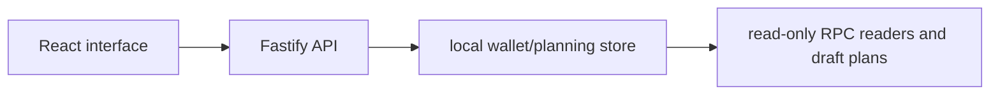

# Wallet Operations Dashboard

**Local account groups, read-only inspection and explicit transaction planning.**

  [](LICENSE)

[Overview](#overview) · [Quickstart](#quickstart) · [Example](#example) · [Validation](#validation) · [Documentation](#documentation)

## Overview

A local BNB Chain wallet dashboard for grouped accounts, read-only inspection and dry-run execution planning.

**Stack:** TypeScript · React · Fastify · ethers · SQLite · Vite · Vitest

## Separate inspection from transaction intent

| Component | Behavior |
| --- | --- |
| Organize | Wallet/group records organize local accounts. |
| Inspect | Market and transaction readers enrich account views. |
| Plan | Launch/transaction drafts and dry runs retain intended operations separately. |

## Processing path



## Quickstart

```console
npm ci --ignore-scripts
npm test
npm run build
```

The commands above install prerequisites or run the specified offline checks. Live collection, cloud operations, messaging and trading are separate operational steps when present.

## Example

**Inspect the workflow**

Inspect the React/Fastify boundary, local group records and planning views before supplying any account material. Use synthetic accounts when examining drafts and dry runs. A stored plan is an intent record, not a signed or settled transaction.

## Configuration and storage

Node.js 24+ is used by the existing project guide. TypeScript, React, Fastify, ethers and SQLite implement the UI/API/state boundary. The local development scripts start API and Vite separately or together.

## Repository guide

| Location | Responsibility |
| --- | --- |
| [src/client/main.tsx](src/client/main.tsx) | React interface |
| [src/server/app.ts](src/server/app.ts) | Fastify API |
| [src/server/db.ts](src/server/db.ts) | SQLite state |
| [src/server/balances.ts](src/server/balances.ts) | Balance readers |

## Validation

The quickstart lists the declared checks. No passing CI or coverage claim is implied by the technology badges.

## Scope and operational boundaries

The original local design stores private keys in SQLite without a vault/unlock layer. This is not a production custody solution; use synthetic data for inspection. Session/database material and real keys are excluded from distribution.

## Documentation

- The repository guide above links directly to the implementation and configuration files.

## License and attribution

Project-authored source code is licensed under the [MIT License](LICENSE). Third-party components and datasets retain their respective rights and licenses.
